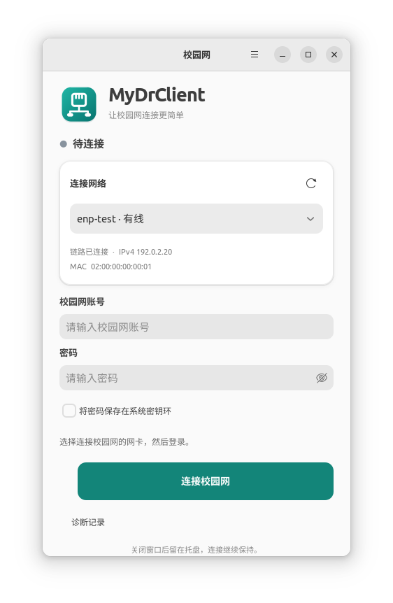
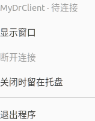

# MyDrClient

面向 Ubuntu 22.04 amd64 的轻量校园网客户端：GTK 4 中文界面，复用已验证的 Dr.COM 认证后台。

本仓库当前版本为独立的 GTK 4 前端，不包含旧 Qt 界面、Qt 资源包或个人网络配置。旧 Qt 版本保留在 Git 历史中。规划见 [PLAN.md](PLAN.md)。



截图使用模拟网卡和测试地址，不代表任何用户的实际网络配置。

## 使用

### 推荐：安装 Release 软件包

从 [最新 Release](https://github.com/Anchirit/SCUT-CampusNet-Client/releases/latest) 下载 **`mydrclient_1.0.0_amd64.deb`**，适用于 Ubuntu 22.04 amd64 / x86_64 图形桌面。其他 Ubuntu 版本尚未验证，ARM 不支持。

先从托盘菜单“退出程序”结束已有客户端，然后双击 `.deb`，用系统软件安装器完成安装。若桌面未关联安装器，在下载目录执行：

```bash
sudo apt install ./mydrclient_1.0.0_amd64.deb
```

安装时输入一次本机管理员密码；APT 会按需安装缺少的系统依赖，可能需要可用的网络和软件源。无需再执行 `privillege.sh`。安装后打开应用菜单，搜索 **MyDrClient 校园网**，点击图标启动；也可以右键图标，选择桌面提供的“添加到收藏夹”固定到 Dock。重启后仍可直接从图标打开。

安装版把完整程序装入 `/usr/lib/mydrclient`，启动入口为 `/usr/bin/mydrclient`，图标和菜单入口位于 `/usr/share` 的标准应用目录。**安装完成后可以删除下载的 `.deb` 或原来的项目文件夹**，不影响安装版运行。不需要设置开机服务；关闭窗口留在托盘的行为与源码版一致。

升级时先从托盘退出，再安装新版本 `.deb`；认证后台仍运行时，安装器会拒绝替换或卸载，避免中断连接。安装版与源码版使用同一应用身份、账号偏好和密钥环条目，切换前务必退出另一个版本；若过去执行过源码的 `privillege.sh`，旧的用户菜单入口可能仍保留，请使用本安装包的 **MyDrClient 校园网** 入口，或在终端运行 `/usr/bin/mydrclient`。安装包不会删除或改写旧源码版的安装。

卸载：

```bash
sudo apt remove mydrclient
```

卸载保留用户配置和密钥环中的可选密码，不删除旧源码目录。Release 同时提供 `SHA256SUMS`，与 `.deb` 放在同一目录后可执行 `sha256sum -c SHA256SUMS` 校验下载内容。

### 从源码目录运行

获取完整项目：

```bash
git clone https://github.com/Anchirit/SCUT-CampusNet-Client.git
cd SCUT-CampusNet-Client
```

也可以下载仓库 ZIP 并完整解压。运行环境为 Ubuntu 22.04 amd64 / x86_64 图形桌面；其他系统和 ARM 架构尚未验证。

先通过菜单“退出程序”退出已有客户端；仅关闭窗口可能仍在托盘中运行。首次在项目目录的终端执行：

```bash
sh privillege.sh
```

按提示输入本机管理员密码。脚本按需安装 GTK/Python 接口，将认证后台和辅助脚本安装到 root 所有的 `/usr/local/lib/mydrclient`，并添加应用菜单入口。

之后直接双击 **`myDrClient`**，或从应用菜单打开 **MyDrClient 校园网**。正常重启不需要重复配置。

1. 先退出旧校园网客户端；新版不会接管旧程序的进程或端口。
2. 选择连接校园网的物理网卡。默认推荐链路和 IPv4 就绪的有线网卡。
3. 输入校园网账号、密码，点击“连接校园网”。
4. 收到后台明确的认证成功响应后，界面显示“已连接”。
5. 点击“断开连接”退出认证。默认关闭窗口后留在托盘，认证继续保持。
6. 从托盘菜单选择“显示窗口”恢复界面，选择“退出程序”才会断开认证并完整退出；窗口右上角菜单和 Ctrl+Q 也可以退出。

已为 MyDrClient 完成首次配置、认证后台没有变化的电脑，更新前端不需要重新执行 `privillege.sh`。通过“退出程序”结束正在运行的前端后，再双击本目录的 `myDrClient` 即可加载更新。从旧 Qt 版迁移时仍需完成新版首次配置。

随包提供原生 ELF 启动入口，无需自行编译。程序使用系统 `/usr/bin/python3`，避免被 Conda 环境影响。主目录中存放完整项目即可；移动目录后，应用菜单中的路径需要重新运行首次配置更新。

## 是否可以独立运行

**Release 安装版可以独立运行**：完成一次安装后，所有运行文件由系统软件包管理器管理，无需保留仓库目录。

源码目录也包含前端、图标、原生启动入口、认证后台原文件及安装脚本，不依赖旧 `DrClient` 目录。若选择源码运行，则有以下要求：

- 日常双击 `myDrClient`，同目录的 Python 代码和图标必须保留。
- 系统依赖为 Python 3、PyGObject、GTK 4、libsecret、GdkPixbuf 和 iproute2；首次配置按需通过 Ubuntu 软件源安装缺少的依赖，因此可能需要可用的网络和软件源。
- 认证后台需要特权，首次配置会把随包文件复制到 `/usr/local/lib/mydrclient`，设为 root 所有并配置 SetUID。不能只复制启动文件，也不能删除已安装后台后直接认证。
- 复制完整项目到另一台电脑后，需要在新电脑执行一次首次配置。系统内核还需支持随包静态链接的 32 位认证后台；已在 Ubuntu 22.04 amd64 验证。
- 账号偏好、诊断和可选保存的密码位于本应用用户配置目录及系统密钥环，不随项目发布。

源码首次配置会写入上述后台目录和用户应用菜单入口；Release 安装版使用前述系统软件包目录。系统分区需允许 SetUID，内核需支持静态 32 位后台。两种方式都不会配置开机服务，日常运行不自动修改 MAC、IP、路由、内核启动参数、桌面扩展或动画设置。

## 功能与限制

- 仅显示物理网卡，优先推荐已接网线且具有 IPv4 的有线接口。
- 显示链路、IPv4、MAC，缺少网卡、网线或 IPv4 时明确提示。
- 支持登录、断开、取消、认证超时、服务器拒绝和后台退出处理。
- 记住账号及网卡；密码默认不落盘，可选保存在系统密钥环。
- 密钥环锁定或不可用时说明原因，仍可手动输入密码连接，不阻塞认证界面。
- 单实例运行；通信、进程等待和网卡读取不阻塞主界面。
- 托盘显示待连接、正在连接、已连接和错误状态，菜单支持显示、断开或取消连接、退出。
- “关闭时留在托盘”默认开启，可从窗口或托盘菜单关闭，选择保存在本应用的配置文件中。
- 桌面没有可用托盘时，关闭窗口会最小化到任务栏；托盘宿主消失时会重新显示隐藏的窗口，宿主恢复后自动重新注册。
- 托盘采用 Gio / D-Bus，不需要 GTK 3 托盘辅助进程或额外 AppIndicator 安装包。项目自带 SVG 图标，只在本应用中使用私有图标搜索目录。
- 诊断记录脱敏并限制大小；不记录登录请求、密码或完整账户响应。
- 不自动更改 MAC、固定 IP、系统路由或内核启动参数。

本版支持当前校园网使用的普通 Dr.COM/802.1X 认证，不提供 PPPoE 拨号、自动重连或跨平台支持。关闭窗口留在托盘不会自动重新登录；如果认证中断，仍需用户恢复窗口并重新连接。原后台账号和密码的上限是 35 个 UTF-8 字节，超过时会提示而非静默截断。

托盘需要桌面提供 StatusNotifierItem 宿主；测试所用的 Ubuntu GNOME 会话已有该支持。程序不会为此安装、启用或调整桌面扩展。原有“网络设置”按钮已移除。



**网卡驱动异常、网线未接、校园网固定 IP 配置不正确，需要在系统网络设置中解决。** 程序会检查和提示，不会把某台电脑的 MAC 或固定 IP 写进通用客户端。

## 结构

| 文件 | 职责 |
| --- | --- |
| `myDrClient`、`launcher.c` | 原生启动入口及源码 |
| `app.py`、`style.css` | GTK 4.6 兼容的界面与交互 |
| `tray.py` | 托盘注册、状态图标和 DBusMenu 菜单 |
| `mydrclient.svg`、`icons/` | 主图标、私有图标主题和四种连接状态图标 |
| `client.py` | 网卡检查、认证状态、超时及后台生命周期 |
| `protocol.py` | 与原客户端一致的本地 UDP 编解码 |
| `storage.py` | 配置、脱敏日志和系统密钥环 |
| `privillege.sh`、`install.py` | 首次配置及后台安装 |
| `packaging/`、`VERSION` | Release 安装包构建、应用菜单入口与版本号 |
| `vendor/` | 已修复的原认证后台、随包配置、辅助脚本和校验值 |
| `tests/` | 独立测试后台与端到端验证入口 |

图形界面以普通用户运行。旧后台仍需要 SetUID 权限，但提权程序及其执行的网卡脚本都位于 root 所有的固定目录；用户可写的项目目录不作为提权脚本运行目录。此版保留原后台的认证实现及其局限，不声称已重写或完整审计原厂后台。

程序设置位于 `~/.config/mydrclient/settings.json`，只保存账号、网卡、记住密码和关闭留在托盘选项；诊断位于 `~/.local/state/mydrclient/client.log`。密码由系统密钥环管理。上述路径支持对应的 XDG 环境变量。

## 验证

### 802.1X 成功后，获取用户属性超时

认证有多个阶段。交换机侧 802.1X 成功后，后台仍需通过 UDP 61440 完成用户属性校验；界面只有收到最终成功响应才显示“已连接”。

如果同时连接 Wi-Fi 和有线网络，默认路由可能让后续 UDP 报文从 Wi-Fi 发出。应核对实际认证服务器的路由和所选网卡是否一致；需要两张网卡同时使用时，可在系统网络配置中为实际认证服务器设置经有线网关的专用路由。服务器和网关以本机实际情况为准，不要照搬其他电脑的 IP。客户端会在用户属性超时时提示检查这一情况，不会自动改动路由。

### 端到端验证

在图形桌面中运行完整端到端验证：

```bash
/usr/bin/python3 tests/end_to_end.py
```

这个入口集中验证实际 GTK 窗口交互、独立进程通信、登录成功、退出、服务器拒绝、超时、取消、缺少网络条件、端口冲突、进程崩溃、凭据保存调用、脱敏及退出清理。它还验证真实桌面托盘注册、DBusMenu、状态图标、在线隐藏保持连接、独立进程恢复窗口、退出期间重新打开、无托盘时最小化及托盘宿主恢复。模拟后台只接受测试账号。

随后在独立的用户、网络和挂载命名空间中运行首次安装脚本，再启动真实认证后台，验证安装权限、完整初始化、查询、网卡设置、登录请求、超时及清理。安装目录绑定到项目测试临时目录，不改动本机真实系统目录。**测试账号不会发往学校网络，也不会中断旧客户端的现有认证。** 默认测试使用内存密钥环，不写入系统密钥环；本轮托盘更新按此范围执行。

如用户需要另行验证真实密钥环，可主动运行 `/usr/bin/python3 tests/end_to_end.py --real-keyring`，它只创建、读取和删除独立的测试条目。锁定时验证明确失败提示，并在报告中说明没有完成实际读写。

完整验证需要 GTK 4、libsecret 的 Python 接口、当前桌面已有的 StatusNotifierItem 宿主，以及可用的 `unshare` 用户/网络/挂载命名空间。测试不会安装或启用桌面宿主；应用本身在无托盘时仍能最小化运行。结果保存在 `test-results/report.json`。真实校园网账号是否可登录，必须另行在新界面输入验证，不能用模拟认证成功替代。

Ubuntu 22.04 / GNOME X11 上的 19 项端到端场景已通过，包含右上角实际托盘菜单操作及隔离真实后台。公开的脱敏摘要见 [验证记录](docs/verification.md)。`test-results/` 是本地运行测试后生成的目录，不纳入版本控制；README 中的图片是单独筛选的模拟界面截图。

初版前端空闲时一次测得 PSS 约 84 MiB、RSS 约 122 MiB；托盘更新未做同条件内存对比，这也不是与旧版的对照基准。此前已验证密钥环锁定提示，以及解锁后的独立测试条目存储、读取和删除。

本机另已通过正式新版界面完成一次真实校园网认证：802.1X、用户属性校验均通过，界面收到最终成功响应；随后通过有线网卡直接访问学校 HTTPS 网站得到 HTTP 200。验证时同时保留 Wi-Fi，并由本机系统网络配置为实际认证服务器指定有线出口。该结果不替代其他学校、账号或系统环境的验证。

## 构建入口

在 Ubuntu 22.04 amd64 构建 Release 安装包，不需要 root：

```bash
# 构建依赖（已有时无需安装）
sudo apt install gcc dpkg-dev desktop-file-utils
/usr/bin/python3 packaging/build_deb.py
```

输出为 `dist/mydrclient_1.0.0_amd64.deb` 和 `dist/SHA256SUMS`。构建采用运行文件白名单，校验原后台，并将包内文件所有者设为 root；不打入账号配置、诊断、测试结果或 Git 历史。固定 `SOURCE_DATE_EPOCH` 后可重复构建相同的包。

完整安装验证：

```bash
/usr/bin/python3 tests/package_install.py
```

该入口在独立用户、PID、网络和挂载命名空间中，使用私有 dpkg 数据库实际安装、启动、重装和卸载 `.deb`；验证原生入口、GTK 单实例、真实后台初始化及超时清理、在线升级/卸载保护和用户配置保留。需要当前图形桌面以及 `unshare`、`mount`、`dbus-daemon`、`gapplication`、`gdbus`；不会安装到宿主系统，不向学校发送测试账号。完整界面与托盘流程另由上面的 `tests/end_to_end.py` 验证。

预编译入口适用于 Ubuntu 22.04 amd64。修改 `launcher.c` 后可重新编译：

```bash
gcc -O2 -Wall -Wextra -Werror launcher.c -o myDrClient
```

界面和控制逻辑为 Python，不需要其他构建步骤。运行时依赖 `python3-gi`、`gir1.2-gtk-4.0`、`gir1.2-secret-1` 和 `iproute2`，不依赖 Qt、Node 或 WebView。

原 Dr.COM 二进制及资源的权利归原权利人；本项目提供独立前端及兼容性集成，不代表厂商官方版本。
